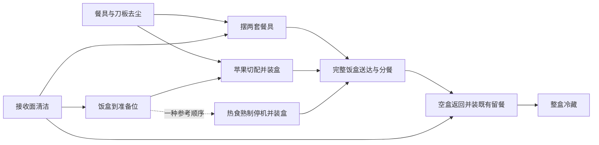

# 四个复合长程任务：加长版 v2

2026-10-21，按“再长一些”的要求，将四个短版候选扩展为完整的工作流程。
新增长度来自设施启用、加工、交付和收尾；酒店 20 只鞋仍是唯一的大量重复操作基线。
当前交付是结构化设计与动作账本，**未生成新版运行时任务、冻结场景或启动仿真**。

## 长度与计数口径

| 任务 | 短版 v1 参考操作 | 加长版 v2 参考操作 | 新增的主要工作 |
| --- | ---: | ---: | --- |
| 庭院维护与双人休息区布置 | 29 | **108** | 园艺工具维护、一张桌子装配、座垫整理、杯具与水果准备 |
| 工作间装配、备柴与交接 | 36 | **101** | 工具实际投入使用、桌子装配与材料覆盖、两根木料加工、整箱产物交付 |
| 厨房启用、备餐与冷藏 | 52–54 | **104** | 餐具与工作面整备、真实切配、分餐后复用同一饭盒冷藏既有留餐 |
| 书房维护与客房入住准备 | 25–31 | **101** | 显示器维护、两件衣物洗烘、卫浴清洁、入住包交付、挂画 |

一次抓取、放置、清洁、切割、接合、设备开关或门开关各计一次；包含工具取放。
导航、观察、等待、失败重试和纯状态检查不计入这些数字。上述是**假定各操作成功的一条
参考流程的条件估算**，不是实测轨迹、最短步数证明或“必须做满 100 步”的评分规则。
账本按阶段汇总动作种类和次数，尚未展开为逐步可执行程序；布局、单手持物和合法批处理
可能改变次数。若动作或资产能力不成立，必须重设计并重算，不保留虚假的步数。

酒店基线保留原合同：20 只鞋。按包含每只鞋的刷子取放的旧参考写法是 140 次非导航操作，
旧 100 次口径未计 40 次刷子取放；该参考也没有完整成功实测，不能作为新版验收依据。

## 1. 庭院维护、设施装配与双人休息区布置：108 次

场景是庭院维护后启用双人阅读茶歇区。两盆植物需护理，另有一盆禁止移动或污染。
整理园艺工具和植物的分支，与装配一张休息桌、准备座位的分支可以交错推进。

| 阶段 | 操作数 |
| --- | ---: |
| 移走书和空罐、移动两座垫、清扫地面 | 11 |
| 两件园艺工具与喷壶外表清洁 | 14 |
| 两盆植物移到作业位 → 喷洒护理 | 4 + 6 |
| 清洁展示架 → 合格植物归架 → 释放后的护理台清洁 | 3 + 4 + 3 |
| 清洁六个部件并装好一张桌子 | 20 |
| 清洁、复原两座垫 | 8 |
| 清洁两杯、摆杯具/茶瓶/果盘 | 14 |
| 取刀板、切一个苹果、两半装盘、刀板归还 | 13 |
| 书归位、摆两灯并开启 | 8 |

主要汇合点：植物处理合格与展示架清洁共同允许归架；桌子完成装配后才能接收茶歇用品；
果盘就位后才能完成装盘。座位准备、园艺维护和桌子装配允许交错，最终需同时满足所有终态。
四条腿属于一张桌子的结构，不复制四张桌子。工具、食品和喷洒区需在冻结布局中隔离。

## 2. 工作间家具装配、备柴与物资交接：101 次

场景是一份同时包含家具整备和备柴交付的工作单。完整工具包外运后，斧头、除尘刷、
涂布刷分别投入实际工作；两根木料生成的四块备柴是独立产物，不能冒充装配桌子的腿。

| 阶段 | 操作数 |
| --- | ---: |
| 工作台清场、擦净 | 7 |
| 三工具装箱闭箱 → 整箱送达 → 开箱同时盘点 | 8 + 2 + 7 |
| 清洁六部件并装配一张桌子 | 20 |
| 空周转箱到加工位 → 两木料切割、四产物装箱 | 2 + 18 |
| 材料瓶取用归还、刷子浸润与桌面涂布 | 10 |
| 整箱送达、四产物卸架、空箱返回 | 12 |
| 工具箱原位清洁 → 工具重装闭箱归还 | 3 + 9 |
| 清扫地面 | 3 |

工具交付与工作台清洁先汇合，随后分成家具装配/涂布与木料加工/交付两路。
工具完成使用后才能最终打包，原工具箱位置也要清洁合格。提前整理不受禁止，之后若再取用
工具，最终仍需完整归还。材料覆盖使用原生 `ink` 状态代理，不声称支持真实木器漆或固化。

## 3. 厨房启用、双人备餐与留餐冷藏：104 次

场景是久置厨房重新启用并服务两人。两人各一盘、一叉、一杯；一个苹果切成两份，
两根热狗熟制后与水果共同装盒送餐。既有三明治和曲奇在初态就存在，作为待冷藏留餐，
没有“人吃完饭”或自动生成剩菜的隐藏环节。

| 阶段 | 操作数 |
| --- | ---: |
| 开柜、取六餐具和刀板 | 17 |
| 八件用品及空出的柜内支撑面去尘 | 11 |
| 空罐入桶，餐桌、准备面和归还台去尘 | 7 |
| 摆六餐具和茶 → 饭盒移到干净准备位 | 14 + 2 |
| 苹果切开、两半装盒、刀归还 | 11 |
| 冰箱取料、微波加热、停机、热狗装盒及设备门操作 | 16 |
| 完整饭盒送达、两人分餐 | 10 |
| 空盒回归还台、装既有留餐、整盒冷藏 | 10 |
| 砧板归还关柜 → 清扫地面 | 3 + 3 |

这里存在餐桌准备、切配和热食三路汇合，之后容器释放，才能进入第二次真实用途。
图中虚线仅表示参考流程：允许饭盒就位前开始加热。柜门/冰箱门的参考开关次数不成为
评分约束。所有尘污均是明确初态；`wipe` 表示仿真去尘，不等同真实洗涤或食品消毒。

## 4. 书房维护、洗烘与客房入住准备：101 次

场景是完成书房维护并准备客房。原收纳量维持两书、一玩具、一笔袋、一键盘；新增一批
两件衣物洗烘，以及杯、饮水瓶、肥皂和纸卷各一件。洗烘等待期间可以推进其他房间工作。

| 阶段 | 操作数 |
| --- | ---: |
| 笔袋入抽屉、书柜清洁 → 两书与玩具直接归位 | 7 + 6 |
| 键盘移开、显示器停机、桌面/键盘/显示器清洁与复原 | 11 |
| 两灯归位并最终关闭 → 两房吸尘 | 6 + 6 |
| 开衣物柜、清洁接收面 | 4 |
| 两衣物装洗衣机、洗完转烘干机、烘干与设备操作 | 19 |
| 湿擦洗手盆、浴缸、马桶 | 6 |
| 空箱就位、两干衣物与四用品装箱、关闭烘干机 | 15 |
| 完整入住包送达、六件分配、空箱归还、关衣物柜 | 17 |
| 两幅画安装到真实挂点 | 4 |

洗烘合格产物先汇入入住包；完整入住包、衣物接收面清洁、卫浴准备三路再次汇合，
允许送达分配。设备维护和挂画另行推进，最终一起交接。吸尘按地面实际腾空状态进行，
不强制等所有物品最终归位。此版不要求折叠、铺床或搭挂布料，也不虚构 `pour` 动作；
洗涤剂预置必须满足原生机器条件，并单独验证。

## 反重复与依赖边界

保留的同类处理均有明确用途：双人六餐具、两座垫、单桌四腿、一次两件洗烘和两木料。
每类数量与理由写入结构化设计；全任务依然有较多抓放和清洁，不能宣称每一步都不同。
庭院含工具共 28 个可动物体，其他三项为 17、18、20 个；“不大量复制同一种物品”不等于
总物体数极少。合法整体搬运、合并工具使用或更短路线均允许，减少动作不导致失败。

这些分叉是必做工作之间的偏序依赖与资源汇合，**尚不是根据观察结果选择不同任务内容的
条件分支**。每项列出三种宏观参考顺序，但静态图不能证明单手程序可执行，终态检查节点
也不增加物理动作。接收面应检查当前状态，不能用“曾清洁”掩盖后来再次污染。

## 验证现状和落地门槛

| 内容 | 当前证据 | 新版仍需验证 |
| --- | --- | --- |
| 来源、动作账本、依赖图 | 静态审查通过，12 个宏观顺序合法，6 项账本守卫测试通过 | 可执行逐步参考与实际次数 |
| 取放、开关、擦拭、喷洒、切割、挂接 | 接口存在，部分旧任务实例有任务级证据 | 新模型、布局、材料、可见性和混合载荷 |
| 家具装配 | 原生 BDDL 来源已固定 | 接合点、稳定性、承重及单手操作 |
| 苹果切割与产物 | 现有切割接口；苹果清洁来源不证明可切两半 | 两个真实、可抓取子件及谱系 |
| 材料浸润/涂布 | 接口与 BDDL 来源 | 新桌面对材料兼容；目前无本版完整物理通过 |
| 两件衣物洗烘 | 原生任务来源 | 布料抓放、机器条件、真实洗净/干燥转换与装箱；主要研究门槛 |

所有新运行时配方、场景、完整参考、16 个物理负例及视觉模型试验仍为 `planned`，
`benchmark_ready=false`。BDDL 文件哈希不是模型/资产绑定验收。能力探针失败后应调整设计
并重新计数；旧任务失败证据、冻结输入和回放不承接新版结论。

文件入口：

- [v2 结构化设计与分阶段账本](../task_designs/nonrepetitive_v2/catalog.json)
- [原生任务来源及 SHA-256](../task_designs/nonrepetitive_v2/native_sources.json)
- [短版 v1 历史设计](nonrepetitive_long_horizon_redesign.md)
- [静态审查脚本](../scripts/audit_long_workflow_designs.py)

本轮批次记录位于共享工作根目录 `operations/long_horizon_extension_20261021/`。
推荐落地顺序是厨房、工作间、庭院、书房/客房，各自先做能力小闭环，再编译和冻结整任务。
