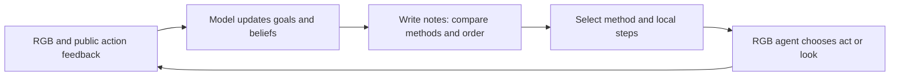

# Hierarchical goals and general DAG planning

`goal-decomposition` teaches a revisable goal tree with variable depth and branching.
The agent writes the root as a concrete terminal state in its own words. Requirements
and constraints from the instruction remain a separate coverage ledger. Any goal can
have children and further descendants; different branches need not have the same
depth or number of children. `parent_id` expresses decomposition; `depends_on`
expresses prerequisites, including across branches. Both relations are acyclic.
The current goal's immediate steps and next check live separately in `active`.
Completed children do not prove their parent without checking its result. New
observations can expand or revise the tree and reopen disturbed results without
erasing requirements. The skill is generic; it supplies no task-specific BDDL or
evaluator feedback to the model.

The shared `task_notes` MCP tool stores up to 12000 characters of model-authored text.
A write replaces the current note using `expected_version`; stale writes fail and
same-request retries are idempotent. `task_notes.json` stores the current snapshot;
accepted writes and all rejected attempts remain in the ordinary append-only event
ledger. Reads and writes do not advance physics or consume act/look steps. The
store accepts free-form text and does not prescribe a hierarchy or assess its truth.
A model after context compaction can read the same notes again.

The hierarchical skill specifies `goal-tree-v2` JSON in
`skills/goal-decomposition/references/working-state.md`. The notes store accepts
free text; recognized trees also drive the CPU planner in `agent/task_planning.py`.
The planner uses the model's public beliefs, never simulator or evaluator state.

## One tree, costed methods, and the action loop

Executable goals carry candidate `methods`. These can describe discovery,
processing, assembly, device operation, arrangement, transport or verification.
There is no fixed list of task types or task-specific plan template. A method
predicts one or several results (`also`), names its prerequisites (`requires`),
resource setup and effects, work locations and cost. Intermediate nodes without
methods organize results; a method on an intermediate node checks its result
after the children. Methods and dependency edges form the executable work DAG
on the same goal tree, rather than a separate transport plan.

Method effects mean complete predicted results, not arbitrary progress toward a
broad phase. Inspection of one storage location needs its own result node if
other locations remain unknown. Each operation depends on the information and
inputs it actually needs, so incomplete discovery elsewhere does not impose an
artificial barrier across the task. The model authors these semantic boundaries;
the scheduler cannot verify them from private simulator state.

The scheduler compares method choices and order across all modeled unfinished
branches. It tracks predicted resource states and travel over observed work
areas. Cost is local work + travel + setup changes + expected recovery + wait, in
estimated seconds. It reuses setup where feasible and can choose shared work
over separate methods. Beam search is bounded to 32 states per coverage level;
it does not prove a global minimum. Cost comparisons cover the same set of goal
results, even when the graph is incomplete. Missing methods, routes and resource
transitions remain visible; partial-plan cost is not whole-task cost.
`unplanned_results` includes the omitted result descriptions and prerequisites,
so a coverage gap can be refined without mistaking discovery-only advice for an
end-to-end plan. The skill starts from a whole-task outcome outline and adds
methods for known future work, not just the immediately executable branch.

1. `task_notes(write)` stores reconciled state with `active:null` and returns
   `planning`: coverage, candidate orders, costs and a recommended next method.
2. `task_notes(select)` records the chosen method and local steps without
   resending the tree. Readiness and immediate cost are computed for that choice
   even outside the three displayed alternatives. Remaining-plan comparisons
   require a retained path covering the same results; missing comparisons stay
   null, including when the beam pruned that first choice.
3. `act/look` preserves the declared method and records public feedback and
   server tool time. The selection carries that method's estimated work, travel,
   setup and recovery costs separately from the entire remaining-plan cost,
   so its accumulated execution time can inform the next estimate. Partial or
   failed execution is not a completed-method timing sample. The previous
   recommendation is withheld after an action,
   since the world may have changed. The agent can continue the local method.
4. At completion, failure or changed assumptions, the model updates actual
   beliefs and estimates through `write`; the remaining DAG is recomputed.

Selection does not execute a script or constrain target pixels. The harness
does not automatically mark goals done from expected effects or a successful
primitive. Physical execution and the independent evaluator are unchanged.
The old preparation/transport planner remains for historical callers and
comparison arms; new generic notes need no duplicate `transport` graph.

Present limits: the model must author enough alternatives and realistic costs.
One-item graphs and room-wide labels that hide travel cannot establish general
efficiency. Tool time includes simulation/rendering and excludes model requests;
it is not simulated physical time. Optional process clocks model unattended work:
methods `starts` predict new processes, `simulation_seconds` advances all running
processes during independent work, and `awaits` accounts for the remaining delay
before a result check. Notes retain estimated remaining simulation seconds in
`planning.processes`; `wait_cost_per_sim_second` converts waits to tool cost.
Unknown processes or missing wait rates remain explicit gaps. Predictions wait
before the checking method's travel/work and start processes at method end.
Only public capture timestamps provide actual elapsed simulation time in action
feedback. On reconciliation the model updates remaining durations and checks
results; elapsed time never automatically changes a goal's status. Process
conditions and duration estimates remain model responsibilities.
Replay selection records show what
the model declared, not independent proof that its actions implement the method.
Efficiency requires autonomous outcome, action, travel and timing evidence.

## Historical goal-skill ablation

For the historical matched ablation, `--goal-skill hierarchical` exposes the skill
and instructs the model to read it before acting. `--goal-skill none` omits its
catalog entry, resources and instruction. Both arms use the same seven tools,
other frozen skills, common prompt, working-note storage, task instructions,
instances, seeds, source commit, model, execution budget and independent evaluator.
The shared visual skill no longer references a missing goal skill. Both arms must
write an initial intended approach (`--require-task-notes`); the control chooses its
own format and decomposition. An early act/look without notes is rejected and
counts as an attempted step in both arms. There are no scripted targets or plans.

The historical paired experiment has 100 attempts per arm with gpt-6.1-sol low, 50 act/look attempts including
failures, no episode wall deadline and no policy retries. Startup and closure
watchdogs stay separate. The experiment estimates the effect of the hierarchical
skill over an otherwise equally equipped GPT controller; it does not isolate
planning from persistence by withholding storage from the control.

Subsequent long-horizon development runs use unbounded episodes under the user's
October 22 instruction. Frozen attempts keep their original skill and budget; the
v2 revision does not rewrite historical v1 notes or change an active episode.

Replay exports preserve the note version before and after each tool call and the
actual agent-step number. Replay displays recognized v2 trees at their authored
depth, with statuses, dependencies, evidence, active steps and revision notes.
Legacy v1 L1/L2 records remain supported. Invalid parent graphs and arbitrary control
prose stay verbatim; no missing hierarchy or hidden reasoning is invented.
Earlier action steps never inherit a later completed tree. The official score,
model completion claims, transport alignment and process exit remain separate.

Report overall and instruction-source-stratified success (first 50 detailed and
last 50 short phrases), paired discordant outcomes, Q score, act/look attempts,
model tokens and infrastructure failures. Planning adherence (skill read, initial
notes/tree, revisions) is descriptive, not a substitute for goal quality or task
success. Preserve failed attempts and missing scores. One seed does not establish
repeatability or the long-horizon research claim.
