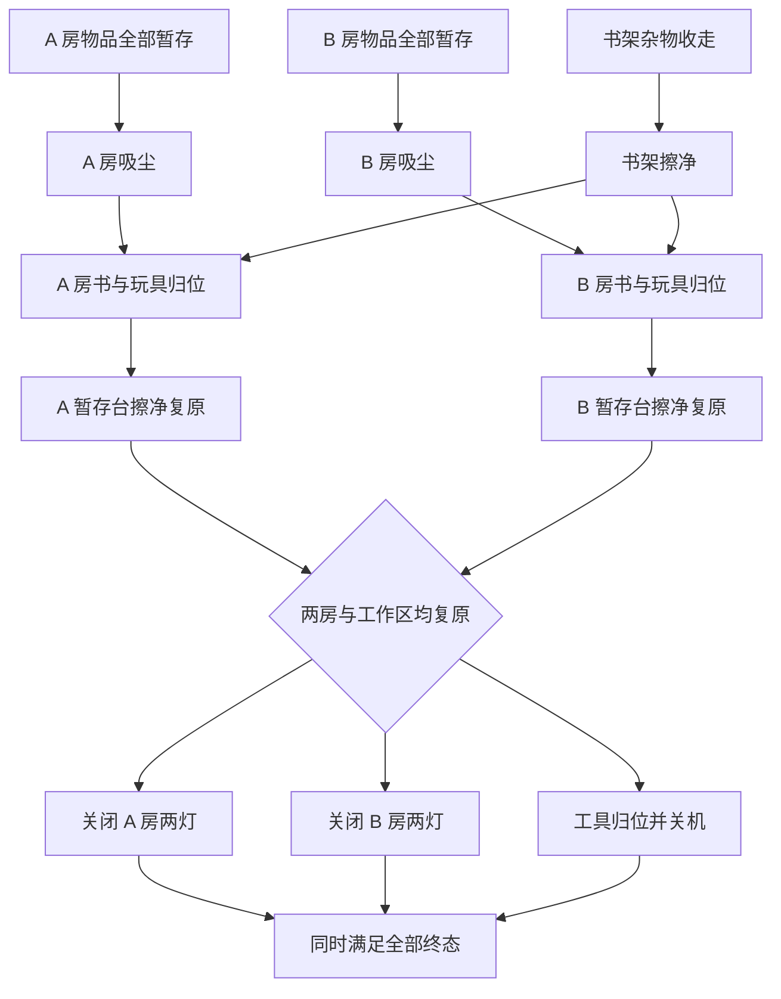

# 长程任务的依赖复杂度与下一版设计

2026-10-20 用户新增要求：长程任务应具有复杂前后依赖、多个分叉。
当前四个冻结任务仍保留原评分含义；本轮检查与新候选设计不改变历史结果。

## 2026-10-21：避免靠同构重复堆动作长度

用户随后明确只保留一个重复操作基线；当前选择鞋履护理，其余四项已有
[独立新版设计与优先级](nonrepetitive_long_horizon_redesign.md)。下方早先将庭院、鞋履、劈木
一并保留为基线的建议已被此选择替代，旧实例和回放仍保留为历史证据。

用户进一步要求：“任务最好不要搞那种大量重复来堆步数”。后续选题和设计审查以此为约束。
100+ 目标只能由有实际作用的完整流程自然达到；不足时如实报告为较短候选，
不得靠增加同款物品、无用途的中转搬运、导航距离或失败重试补足动作数。
原有冻结实例、评分条件和实验结果保持其历史含义。

设计审查同时检查工作内容和依赖结构：

1. **压缩重复后的流程仍有复杂性。** 将同构对象组缩为完成该功能所需的少量代表，
   再检查剩余流程是否仍需多阶段计划、不同工作分支和跨分支汇合。
   对象数量影响容量或批次安排时，单独说明其物理作用；不能只用数量证明复杂。
2. **每条链承担不同的实际工作。** 例如食物处理、目的地清洁、装载运输、分餐和设备复原。
   两个区域执行同一清洁链需要记作重复；仅换对象类别或动作名称也不自动成为新流程。
3. **依赖有真实原因。** 产物、干净表面、空间、容器或设备状态为下一阶段创造条件，
   允许合理交错和共享工具复用；不得凭空增加顺序、锁门或强制绕行来制造深度。
4. **长度与规划复杂度分别报告。** 区分不同工作流程、同构重复次数、必要有效操作、
   导航/观察和失败恢复。抓放并非天然无意义，但大量抓放也不能证明存在大量规划决策。
5. **条件分支须来自可观察状态。** 仅在原生能力和评分支持时引入“检查后选择处理方式”，
   不能把未实现的条件分支算进现有任务能力。

据此调整开发优先级，而非重新解释已有验收结果：

| 任务 | 后续定位 |
| --- | --- |
| 庭院、酒店鞋履、车库劈木 | 保留为重复操作和执行器回归基线，不再优先扩展对象数量来充当主要长程规划任务 |
| 双卧室清洁 | 保留区域清空、清洁、复原的依赖素材；新设计需减少同构搬运占比 |
| 双卧室与共用书柜 | 保留跨分支汇合设计，但需重构重复工作量，不能仅凭分叉数就作为主推方案 |
| 午饭、电影夜、工具运输及其扩展 | 优先审查能否组合为自然的异质工作流程；已有子流程和历史成功不等于新组合已可执行 |

共用书柜的现有条件账本中，24 件物品两段搬运为 96 次抓放，6 件书柜杂物搬运为 12 次，
合计 **108/117 次（约 92%）** 属于物品搬运抓放。这个比例不是通用难度指标，
但结合重复的对象处理链，说明它仍需削减重复内容。其 15 个里程碑和多次汇合并不能抵消这一问题。
新版本应另建配方和验收记录，不修改原冻结任务或把减量后的任务声称为已满足 100+。

## 当前四项的实际结构

依据 `operations/long_horizon_build_20261020/frozen_tasks.json` 指向的冻结任务，
直接检查 `evaluation.milestones`、`after`、`state_guards` 及终态。
下表数字只统计显式里程碑子图：深度按节点层数，未展开最终摆放、guard 隐含顺序、
物理可达性或资源争用，不是完整规划深度。

| 冻结任务 | 里程碑 / 边 | 显式最大深度 | 显式内部 AND 汇合 | 实际判断 |
| --- | ---: | ---: | ---: | --- |
| 庭院 | 40 / 20 | 2 | 0 | 20 条相同的上台→喷洒链，之后按 guard 才可送达；分配与对照保护增加约束，跨支路依赖少 |
| 酒店鞋履 | 40 / 20 | 2 | 0 | 20 条相同的上台→去尘链，再分配到 10 个鞋位；同款鞋等价配对不构成不同工艺分支 |
| 双卧室 | 5 / 4 | 3 | 1 | 两房各自全量暂存→吸尘，归位条件在汇合处检查，之后才能关灯；有基本分支与汇合 |
| 车库 | 33 / 32 | 3 | 0 | 扫地节点展开为 16 条上墩→切割链；每根两半都需收纳，但加工支路同构 |

最终成功总要满足所有终态；上表的 0 个内部汇合不表示没有最终全量检查。
也不能把 20 条同构链的数量或单纯增加物体数解释为 20 种规划分支。
这些任务适合作为大量逐件操作和过程约束的基线，目前不足以承担复杂任务分解的主要实验。
四项依旧没有完整参考通过，不应以依赖图分析替代物理验证。

## 新的设计目标

以下是 2026-10-20 的依赖设计目标，后续使用时同时遵守上方 2026-10-21 的反重复约束。
动作长度和依赖结构分别验收。100+ 必要有效动作须来自有意义的工作流程，另外检查：

1. 至少三个有独立作用的工作分支，包含至少两种不同工作流程；同构对象副本单独报告。
2. 至少两种有实际作用的非最终汇合：例如“目的地准备 × 物品处理”以及“多区域复原 × 闭场解锁”。
3. 包含汇合后再次分叉，避免只有“所有小任务 → 结束”这一层结构。
4. 至少两处跨分支的资源或产物依赖，写明哪项工作给另一项创造了什么物理条件。
5. 宏观关键路径拟达到六层左右或更多；不把导航、抓取、放置等机械拆词当作加深语义链。
6. 给出至少三种不同的合法分支执行顺序，包括交错推进；仅倒转同款物体编号不计为不同策略。

以上为本项目候选设计门槛，尚非经过标定的通用难度分数。
每条边必须能解释为场景中的可用空间、干净表面、合格产物、设备条件或明确公开的流程要求；
不能仅为了图复杂而规定任意先后。单机器人仍一次执行一个动作，独立分支表示允许交错安排。

## 第一项具体候选：双卧室与共用书架复原

[结构化候选](../task_designs/branching_candidates/bedroom_shared_library_v2.json) 为 `design_only`，
包含节点、公开要求草稿、资源、动作账本、三种合法宏观顺序与物理负例计划。
该设计文件本身不属于 runtime recipe。用户随后要求实际尝试构建，新增了
[独立的可构建配方与验证记录](branching_library_construction.md)，已通过场景构建，
尚未通过完整物理参考验收；原四个任务保持不变。

静态检查得到 15 个宏观节点、17 条依赖边、2 个出度大于一的分叉节点、
3 个非最终 AND 汇合和 1 个最终汇合；最长路径为 7 个节点（含最终检查）。
这是候选宏观图的指标，不可直接与旧任务未展开 guard 的里程碑深度当作同口径难度分数。
三种宏观顺序均通过依赖检查，尚未通过物理执行。

本房吸尘完成后，书架未准备好就不能上书；书架准备完毕可以同时解锁两房的后续归位。
A 房先完成时，仍可处理其他分支，但不能提前关任务灯。吸尘器由两房共用，
擦拭工具由书架和两张暂存台共用，单手和真实支撑容量限制继续存在。
归还工具允许穿插进行，最终已经归位时不要求再取放一次。

条件动作账本为 **117**：24 件两段搬运共 96 次，书架六件旧杂物归置 12 次，
两房吸尘 2 次、三个独立表面擦拭 3 次、关四灯 4 次。工具交接、导航、观察、等待和失败另计。
此数依赖物体与工具可用、公开逐件协议生效等前提，尚非实测长度或物理最短解。
共用书架、额外物体、表面去尘兼容性和全场通路均尚待构建验证。
暂存台初始设为有尘；不得虚构搬物会自动产生灰尘。

## AND 分支与条件分支分开实现

第一项候选中的各支路都必须完成，是带多次汇合的偏序任务。
如需根据真实观察选择路线，另外定义条件变体，例如“物品有尘先清洁、已干净可直接进入分配”。
这种变体必须具有可观察且可可靠识别的初态差异；不能使用模型看不到的隐藏标签。
观察要选择哪条支路，不等于把 `look` 算作必要物理工作来凑长度。

当前 `TemporalGoalEvaluator.result()` 要求所有已声明历史里程碑都成立，
不能直接把互斥的两条路线一起列为必做里程碑。未来实现条件分支需要明确：

- 根据哪个可观察物理事件确定激活路径，何时锁存；未激活支路不能记作漏做。
- 条件支路的接续、汇合与必要终态，不能把任意 OR 谓词误称为路线选择。
- 各个允许路径的必要工作量，不能只拿最长的一条声称都达到了 100+。
- 误选路线、提前操作后补齐终态、前提被破坏等负例。

恢复循环（例如意外落物后重新拾取）也应单独报告，不把失败重试预先当作任务长度。

## 评分与验证要求

`after` 主要约束里程碑授予；若动作提前发生而其结果持续存在，后来可能仍获得里程碑。
因此须结合物体级状态/事件 guard 验证公开顺序，并保存永久违规，不能只检验最后图是否“走通”。
历史 clean 与当前 clean 分开：目的地曾清洁不代表后来仍可接收干净物品。
最终终态应同时成立，不能用过去出现过的正确状态替代最终完成。

验证按层记录：图结构/账本/合法顺序静态检查 → 原生物理能力与新场景 → 多顺序完整参考
→ 缺前提负例与状态退化负例 → RGB 可见性和自主模型。
本轮只完成当前结构审计与新候选静态设计，不启动仿真或恢复暂缓的执行器修复。
