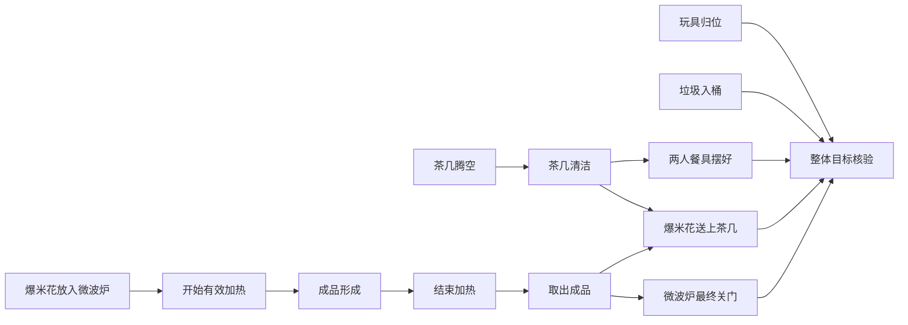

# 带偏序依赖的长程任务原型

本稿对应 `task_designs/partial_order_v1.json`。这是可做静态检查的设计规格，
不是可直接交给 BEHAVIOR runner 的实例。三个任务的联合场景、物理可行性和
独立评分器尚未验证，不能称为已经跑通的新 benchmark。原 100 任务的配置不变。

## 为什么不能只看指令字数或执行时间

当前 100 任务包含 50 条详细指令和 50 条短语指令。详细组英文词数中位数为 40，
范围 11–88；短语组中位数为 4，范围 3–9。短指令不等于短任务。
做披萨有取食材、加工、组合、加热，多个收纳任务需要反复处理 6–10 个物体。

当前实验最多 50 个 act/look 请求；失败请求也计入，笔记和 skill 读取不计入。
没有任务总墙钟时限。导航单次阻塞一小时不会产生一小时的任务进展；一个执行器错误
使任务在第 1 步结束，也不能说明它本来只需 1 步。成功轨迹的长度仍受预算筛选。
本次运行长度快照在共享工作区 operations/partial_order_task_design_20261014/ 中，
不将未完成任务的最低所需步数猜成已测数据。

建议分开报告：成功参考轨迹 act/look 数、搬运对象数、跨区域次数、L2 子目标数、
依赖图最长链、可独立推进的分支数，以及需要临时占用/释放的共享资源。
参考轨迹长度只是可行上界，不是最短解证明。图的节点粒度也必须统一。

## 树与偏序图各自负责什么

L1 是用户目标与允许的解释，L2 是结果级子目标；两者保留目标树。
L2 之间另外有依赖 DAG。L3 是当前子目标的短动作计划，动态生成，不提前固定所有像素动作。
当前 goal-tree-v1 已有 `depends_on`，能够表达这一结构，但只是模型写的笔记：
工具不会自动检查环、真实前置状态或证据真实性。

边 A→B 表示 B 的相应完成里程碑需要 A 的结果，不能因“通常这样做”就加边。
无边的两分支可以交换、交错执行；单机器人仍不能同时抓两件物品。
两条分支争用同一个夹爪、台面或设备属于资源约束，不一定要永久变成先后边。
被动物理过程也只随仿真步推进，不能把模型思考的墙钟时间算成加热时间。

区分三种信息：

- 临时状态前提：例如容器可用。使用时核验；变化后重新检查。
- 已发生的阶段事件：例如工具箱已经完成运输。之后开箱不抹去运输历史。
- 最终目标：例如工具在维修台、空箱回原位。结束时所有这些条件必须同时成立。

参考 DAG 描述一种结果层分解，不要求模型节点名称和图结构与答案逐字相同。
只有公开说明的历史要求才作为额外硬约束；其余采用真实状态前提及最终目标评分。
模型可以更早做部分工作，或选择等价分解，不能因没有照参考顺序排动作而扣分。
当一个前置结果被后续动作破坏时，依赖它的当前状态证据需要重新核验；
被合法消费的阶段里程碑不应机械地重开。

## 第一版任务族

| 任务 | L2 数 | 最长依赖链（节点） | 主要结构 |
|---|---:|---:|---|
| 午饭准备并恢复厨房 | 12 | 4 | 食材、饮料、饭盒准备汇合；送餐与收尾分支 |
| 电影之夜准备 | 13 | 6 | 爆米花处理链与清洁摆台分支汇合；玩具、垃圾独立归位 |
| 维修工作区准备 | 13 | 7 | 找齐→装箱→闭盖→运输→开箱→摆工具→空箱归还；清洁台面独立推进 |

前两者复用现有做热狗、饭盒、爆米花等任务中的资产和状态机制作为候选；
第三个参考工具箱收纳及桌面整理。候选任务同处一个场景类别不代表它们的
301 实例拥有相同对象集合，更不能直接合并不同实例的 JSON。
必须创建单一联合初态，固定对象身份、容量、位置、关系和随机种子。

电影之夜的一个简化图：

摆餐具和摆零食没有强制顺序。加热期间可推进桌面、玩具和垃圾分支。
“工作都分成几段按顺序做”不是这里的目标；需要模型识别哪些分支可推进、
哪些要等前提，以及哪些已完成结果需要保护。

## 模糊指令怎样公平评分

给模型的是简短的 public_instruction，加可见/公开的家庭约定 public_context、RGB 和普通工具反馈。
例如“准备午饭”不能暗中被评分为“必须两根热狗且放进某个隐藏指定饭盒”。
菜单、数量、终点与设备终态要么公开，要么事先定义多种可接受解释。
任务规范中的对象 ID、私有绑定、参考 DAG 与评分谓词不发给模型。

先评“目标明确但步骤省略”；再单设开放解释组。开放组允许在执行前承诺合理方案，
或者对影响结果的歧义发起澄清，并使用预先冻结的接受规则。不能运行结束后改评分来迁就输出。

## 难度扩展与对照

按对象数量、跨区域距离、关键链深度、分支汇合数量、共享容器和中间状态复用分别扩展。
优先做对象数和搬运成本相近、依赖结构不同的配对版本，区分“重复搬更多物品”与
“真的需要管理跨阶段依赖”。加入替代路线时使用分支/OR 前提，不把所有替代方案
都写成必须完成的 AND 子目标。

100/200/300 agent steps 仅为新任务预算标定候选，先用 200 的独立 pilot 配置验证。
用多条可行参考轨迹估计执行需求后再冻结难度档位；目前没有测出这些任务实际需要
80 或 150 步，不能以估计代替结果。维持单动作预算，避免一次规划拖住整个 episode。

在同一模型 gpt-6.1-sol low、执行器、任务初态与预算下比较：
无目标 skill、当前两层目标树 skill、加入依赖/证据维护的版本。
所有组保留相同的通用笔记工具。报告多种随机初态、未用于改 skill 的组合与场景。
不把我们自己的参考 DAG 喂给任一正式模型组。

指标包括完整目标成功、各必要终态同时成立的比例、公开顺序约束违反、已完成目标被破坏、
恢复后保留原目标、重复失败动作、工具/模型耗时，以及基础设施错误。
规划质量使用状态和事件证据，不能以写了多少笔记或目标树格式漂亮作为主要指标。

## 从设计到真实实验的准入

1. 离线核验源资产及动态转化依赖；针对选中资产解析 USD、验证布料/关节/容积等能力。
2. 一次构造联合场景，保存可重载初态；校验可达性、容器容量、目标未被初始状态提前满足。
3. 给每个结果条件绑定私有实体和正式状态谓词；区域清空等额外检查必须独立实现并验证。
   BDDL 终态与需要事件轨迹的运输约束分开，不能只从最终快照推测历史。
4. 脚本物理验证每条关键边及至少两种合法分支交错；同时保留缺前提、内容物掉落等负例。
5. 最后启动独立自主模型试验并保留视频、tool 对齐、模型 finish 和独立评分。

静态检查命令：`python scripts/validate_task_designs.py task_designs/partial_order_v1.json`。
它检查引用、环、终态集合和多种拓扑顺序，只证明规格的图结构成立。
