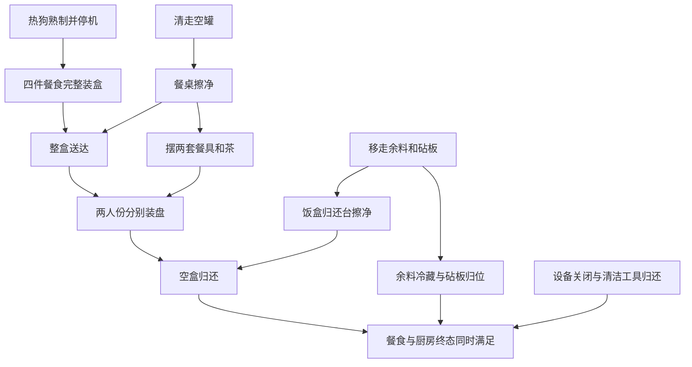
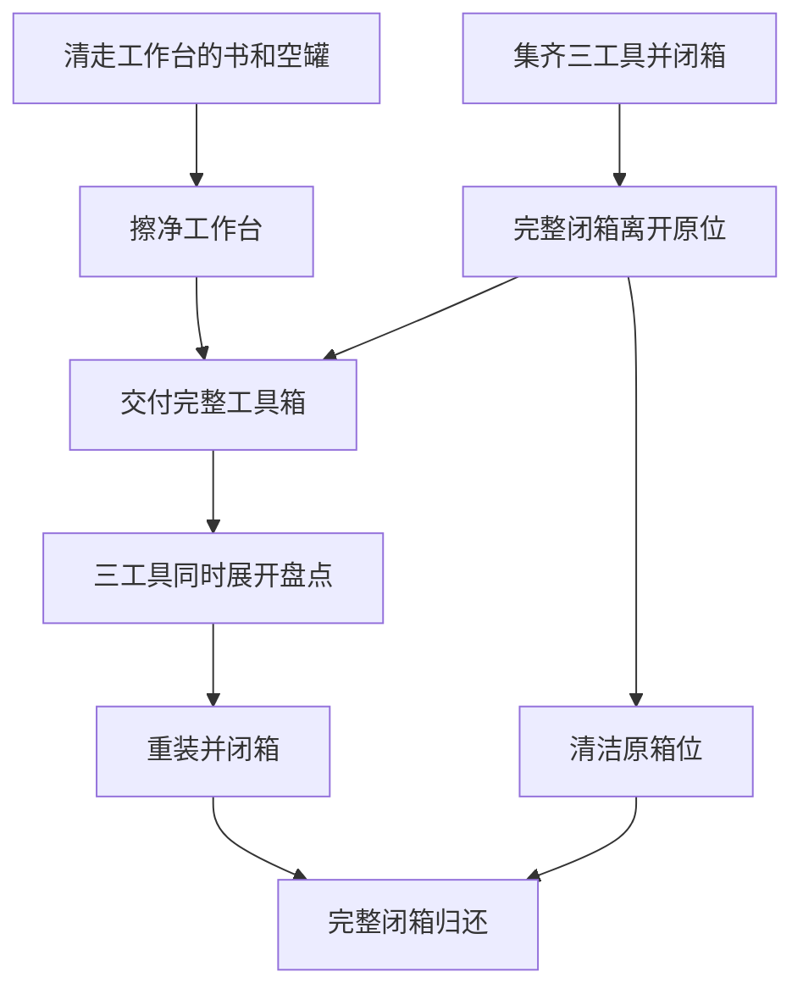

# 长程任务重设计：一个重复基线与四个复合任务

> 版本说明：下文保留短版 v1 设计。随后按“再长一些”的要求新增
> [加长版 v2](extended_long_horizon_designs.md)，四项条件参考账本为 108、101、104、101 次
> 非导航操作；仍为设计阶段，没有最低步数证明或新版物理测试。当前开发候选以 v2 为准。

2026-10-21 用户要求保留一个大量重复处理的任务，其余部分重设计为复杂任务。
本轮交付是 [四个新版结构化设计](../task_designs/nonrepetitive_v1/catalog.json)，包含公开要求、
物品数量理由、依赖原因、三种宏观参考顺序、四个负例和能力验收门槛。
**它们仍为 `design_only`：尚未编译运行时配方、冻结新场景或进行物理测试。**
旧冻结输入、成绩和回放保留原义，新候选不能沿用旧版验收结论。

## 新的开发组合

| 原任务 | 本轮安排 | 数量与工作变化 |
| --- | --- | --- |
| 酒店鞋履护理 | 唯一保留的重复操作基线 | 保留 20 只鞋的旧合同；用于观察长序列执行可靠性，最新完整参考仍失败 |
| 庭院 20 盆植物 | 少量盆栽养护与庭院阅读角复原 | 2 盆需处理、1 盆免处理；加入护理空间转换、展示架清洁、清扫和阅读桌复原 |
| 车库 16 根原木 | 工具箱盘点与双工作面交接 | 替换工作内容，复用早期工作间素材；电钻、钳子、螺丝刀各一件，完成闭箱外运、同时盘点、重装回运及两处工作面清洁 |
| 双卧室 24 件搬运 | 双人备餐、整盒送餐与分餐复原 | 替换场景，扩展已有午饭/分餐合同；两人份餐食、各一套餐具，加上冷藏、清洁、容器归还和设备复原 |
| 双卧室＋共用书柜 | 书房与卧室联动整理 | 原 24 件书玩具和 6 个笔袋缩为 2 本书、1 件玩具、1 个键盘、1 个笔袋；两个房间承担不同工作 |

原庭院、劈木和双卧室大批量任务退出新开发组合，作为历史实验保留，不再作为额外的活跃重复基线。
新组合没有声称 100+ 必要动作；物理参考完成后再报告有效操作、导航、观察和恢复开销。
既有复合任务提供素材，新设计不是将旧版改名后直接列为新成功任务。

## 优先一：双人备餐、整盒送餐与分餐复原

加热装盒、餐桌准备、余料冷藏与饭盒归还位准备可以交错。完整饭盒送达后需要分餐，
分餐释放的空饭盒要与干净归还位再次汇合。



移走物品表示实际释放表面，不强制先完成冷藏才允许擦台。归还台与食品准备台是独立支撑面；
食品备料区初始干净。餐桌清洁后可先摆餐具或先送盒；加热期间可清桌或储存余料。
不按固定等待次数假定熟制。同类餐食可互换，不指定隐藏身份。合法整体搬运不因减少动作受罚。

关键负例：未熟送达、到桌上才拼成完整饭盒、只分一份就归盒、空盒先放脏归还台再补擦。
新布局、负载搬运、盘上状态、加热/未焦、表面清洁兼容性均须新验证。

## 优先二：工具箱盘点与双工作面交接

工作台清洁与三工具装箱独立推进；完整闭箱与清洁工作台汇合完成交付。
整箱离开又释放原箱位，可在展开盘点或重装之间清洁原位。
重装完整闭箱与干净原位再次汇合，完成归还。



三工具取放仍属同一“工具盘点往返”类别，不因名称不同而报成三种流程。
三件用于小规模完整性检查，不继续扩充数量。盘点的同时展开要求公开给策略。
闭盖和完整性针对实际外运/回运；先清台、先装箱、趁箱子离开清原位均合法。
允许带负载临停来换清洁工具，须在单手物理参考中找到实际可行顺序。

关键负例：逐件取出又立即放回而从未完整展开、开盖运输、漏工具、先归脏箱位再补清洁。

## 优先三：书房与卧室联动整理

共用书柜清空、擦净后解锁两房归书。书房分别清洁键盘和桌面，双方当前合格才可归位；
卧室收玩具并释放地面。两房共享吸尘器，键盘、书桌、书柜拟共享兼容的除尘工具。

- 书柜准备好时书直接归柜，玩具可直接归箱。
- 地面杂物实际清走即可吸尘，不强制先完成最终归书或全量暂存到指定台。
- 键盘可在移开前或移开后去尘，清洁桌面时它需离开工作区。
- 各房灯独立控制，最终关闭即可，删除“两房都完成才许关任一灯”的屏障。

主要物品共 5 件；两本书仍记作同类归书，不用房间标签掩盖重复。
保留共享目的地和“物品合格 × 接收面合格”的汇合，删除旧版 24 件物品两段搬运。
关键负例：脏键盘归位、书放上脏柜、玩具未移走就吸尘、书柜变脏后用历史清洁放行。
键盘资产、工具兼容性、两个地面和全场通路尚待验收。

## 优先四：少量盆栽养护与庭院阅读角复原

阅读桌临时作护理台：收书和空罐后移入植物；展示架腾空可擦净，植物在隔离护理位喷洒。
合格植物与干净展示架汇合后归架，护理桌释放后擦净、归书，恢复阅读用途。清扫可穿插。
免处理植物用于对象保护，不能计入工作量；两盆需处理植物也不是两种规划分支。

这个方案增加空间用途转换，但跨分支汇合种类少于备餐和工具交接，因此排在后面。
不能仅凭十个宏观节点宣传为最高复杂度任务。喷洒隔离、原生家具、容量和通路须先验证。

## 审查与验收边界

结构化文件中，`global` 为公开全局前提，`per_item` 只约束对应物品，
`reference_only` 只是参考顺序，不能自动编译成评分约束。
`check_only` 是状态核验，不能算新增物理操作。四项均为必做工作可交错的偏序任务，
尚未实现根据观察激活互斥路线的条件分支。

```sh
python scripts/audit_nonrepetitive_designs.py task_designs/nonrepetitive_v1/catalog.json
python -m unittest discover -s tests -p 'test_nonrepetitive_designs.py'
```

静态检查覆盖来源定义哈希、一个保留基线、四个替换、现有动作名、无环依赖、
三种合法宏观顺序和负例引用。它不能证明现实合理性、单手调度、长度、容量或物理可执行性。
后续依次编译新配方与评分、冻结场景、执行多顺序参考及负例，再进行真实视觉模型测试。
本轮记录在共享根目录 `operations/long_horizon_redesign_20261021/`。
