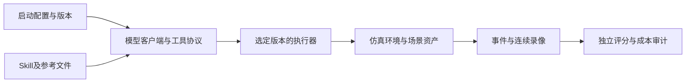

# 一个实验的完整边界

实验身份由代码、输入、协议、环境和证据共同决定。相同模型名、相同SKILL.md或相同Python包版本号，不足以判断是同一实验。

| 层面 | 必须固定的内容 | 本归档的位置或来源 |
|---|---|---|
| 调度与入口 | 启动器、参数、顺序、seed、动作/步数/墙钟预算、GPU锁、初始化/收尾限制 | orchestration快照、plan/job/spec、launch选定元数据 |
| 模型控制 | 客户端与伴随二进制版本、请求model/effort、实际prompt、工具线上schema/strict、续接规则 | 冻结scripts/clients、controller/MCP元数据、环境客户端清单；认证外置 |
| 工具和skill | 开放的工具、参数、decision字段、全部skill及references、实际读取记录 | 冻结tools、skills、episode_skill_snapshot；完整读取事件外置 |
| 执行器 | RGB选点、私有深度/实例解析、导航、抓取/载荷、放置、状态操作、异常反馈 | 对应runtime的executors/backend/observations，不能混用main |
| 任务与评分 | instruction、BDDL、高层状态评分或原生谓词、绑定/成功口径 | runtime任务目录、spec与保存的scoring字段 |
| 场景与资产 | 初态/房间裁剪/外壳、导航图、物体/机器人/材质/粒子资产、生成器及其补丁 | 任务输入和资产manifest；大型资产、生成二进制初态/拓扑缓存外置 |
| 仿真环境 | Python、IsaacSim/Kit/OmniGibson/BDDL、torch/CUDA、驱动/GPU、环境变量、兼容层 | environment记录及各run配置；环境目录不入Git |
| 验收证据 | 模型调用、执行事件、独立评分、失败、首次finish/拒绝、连续录像、分析器及哈希 | 轻量元数据与重算验证入Git；原始事件/会话/媒体在原存储 |

## 各实验族不能互换的部分

- 热饮：已知成功对照使用`high_level_hot_drink_state_v1`；`boil`和热水转移属于已声明的高层接口。普通柜门开关作为环境操作，不直接增加11项任务进度。
- 杂货v2：两袋、逐物体存放、允许的柜体/目的地、载荷保持、NextTo/Inside和导航设施版本共同决定结果。最新杂货候选不能倒填进旧对照。
- 餐后收拾：任务定义与接受位置语义的调查独立保存；准备脚本存在不等于已有通过的自主回合。
- 摆桌/自助餐：原始原生谓词与构造初态、真实采样和布料相关条件构成实验；接口尚未覆盖的要求与构造失败需保留。
- 野派清理：GPU粒子/布料、精确拓扑、场景约简、原生初态与兼容层版本都重要。v68和此前几十版差异必须按运行选择；私有探针14/14不能记成自主成功。
- 公共任务/原子动作/相机/传输探针：目的、是否调用模型、验证的是局部动作还是整任务分别列明；不能用目录名自动判成功。

## 历史版本与当前工作树

`runtimes/local_development`保存了采集时维护工作树的未提交修改，方便同事阅读待移植功能。其身份不覆盖历史实验。先查`catalog.json`的实验路径和快照类型，再恢复相应完整runtime、启动器和任务配置。缺失输入、过深的客户端续接目录或外部二进制仍在`traversal_omissions`和环境说明中，归档不补造它们。

所有版本沿用同名Python包`manipulation_agent`。运行或测试必须把目标runtime的`src`明确放到`PYTHONPATH`，并检查实际导入路径；全局editable install可能指向另一工作树。包版本`0.2.0`不表示源码相同。不要在同一Python进程里切换两套同名包。
