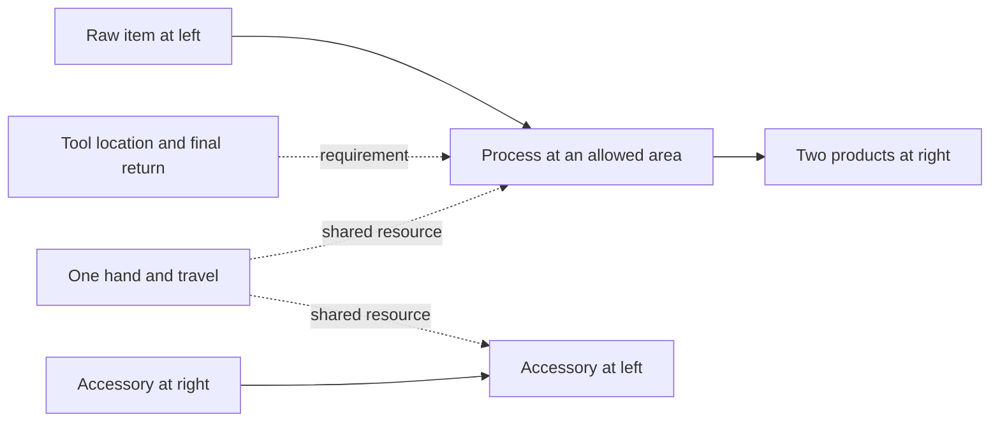
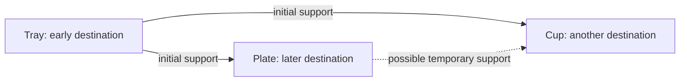

# Minimal resource graphs: processing, delivery, and return work

Status: experimental designs with symbolic tests, an admitted native fixture,
and three completed exploratory RGB trials, **not a released benchmark**.
The latest method-comparison text changed the selected processing location in
one trial, but that trial failed a product's final support condition. Stable
complete-task benefit from text guidance is unproven. The bounded resource planner has improved
selected development cases, including actual model-initiated MCP use. Keep these
two findings distinct when using
these designs. This directory is a maintained design description, not a frozen
scene or an executable native task definition. Generated instances and immutable
run evidence remain in the workspace's experiments directory.

## Processing delivery and reverse return

There are two work areas with usable staging surfaces. Initially, one raw item
is at the left area, one accessory to return is at the right area, and a
processing tool is at a declared area. Processing consumes the raw item and
creates two products. Final requirements are both products at the right area,
the accessory at the left area, and the tool at its declared final area. The
hand must finish empty; the robot's final area is unconstrained.

Natural instruction: "Prepare the two pieces and leave them on the right work
surface. Return the accessory to the left work surface and leave the processing
tool at its designated storage area."

The instruction imposes final conditions only. It does not require a processing
location, batch size, goal order, or use of a carrier. The minimal symbolic
version has no carrier. A separate relaxed version provides a carrier and
explicitly allows its declared loading, processing and unloading operations.
Every compared policy receives the same available actions and public state.

The resource graph contains two causal branches:

The dashed edges are resource relationships, not fixed precedence constraints.
A particular plan resolves processing locations and resource-use order, then
has its own execution dependency graph.

When the tool starts and finishes on the left, two useful complete strategies
in the no-carrier discrete model are:

| Strategy | Sequence | Cost when each move costs d and other actions cost 1 |
| --- | --- | --- |
| Process on the right | Deliver raw item; return accessory; bring tool right and process; return tool left | 4d + 7 |
| Process on the left | Process; deliver product 1; return accessory; deliver product 2 | 3d + 9 |

These strategies tie at d=2. Exact development checks at d=1/2/4/6 find costs
11/15/21/27. The best of the two serial goal orders costs 13/17/25/33, even when
resource restoration is required only at the end. This is a small, concrete
example of choosing processing location together with return work.

It is **not yet a skill-discriminating benchmark**. A fixed six-configuration,
two-repeat screen with gpt-6.1-sol / low completed 36 legal plans. A/shared
guidance and D/resource-graph guidance each reached the optimum in 11/12 cases,
with total cost 197. B/original planning guidance reached it in 9/12, total 199.
The optimum total was 196. D and A had identical cost in all paired cases.

## Processing with a carrier

The companion task uses two raw items, a processing tool, a carrier and two
work areas. Product delivery and tool/carrier restoration remain terminal
conditions. Processing may happen at either area. Capacity must follow the
actual carrier and object geometry, rather than an arbitrary slot assumption.
An ample-capacity symbolic variant still changes its preferred processing area
when the tool's starting area changes.

A frozen finite method enumerator covers twelve combinations of processing
area, direct/carrier transportation, and separate/shared resource return.
It found a complete legal plan in all 480 prospective parameter cases, and
contained an optimum in 314. Mixed processing locations, mixed direct/carrier
transport, and productive trips to obtain resources remain coverage gaps.
This is a program planning method, not evidence that a text skill helped.

## Native construction and acceptance

Construct a compact pair of physically usable work areas; retain all legal
staging and transport options. A no-carrier instance must actually lack an
available carrier, rather than expose one and forbid a policy from using it.
The native executor also carries supported assemblies: absence of a box alone
does not establish the symbolic one-loose-item transport assumption. If stacking
products creates a legal transport option, include it in the public model and
re-evaluate the strategies. Do not disable it to preserve a symbolic result.

Acceptance requires native initial assertions, full references through the
checked executor, a fresh restore, and matched autonomous trials under the
same frozen task/scene/source/skills. Record task success separately from
controller termination and evidence integrity. Native automatic material
transitions and settling must be reflected in the action model; symbolic
operation counts are not measured execution costs.

Existing local probes establish one-raw box cutting, retained products and
batch pouring. A floor-surface-cut probe and a second-raw grasp previously failed
in approach search. A separately authored raw-on-counter fixture subsequently
passed fresh initial assertions, cutting, and product support after settling
(three actions). This establishes a local surface-processing capability, not
this complete task, and does not replace the earlier failures.

## Evidence

Generated evidence is outside Git, under
`experiments/planning_strategy_refinement_20261102/` in the workspace:

- `backhaul_graph_r1/`: exact cases, stronger serial comparison, no-carrier ablation.
- `backhaul_model_r1/`: frozen 36-call A/B/D screen, all answers and replays.
- `method_coverage_r1/`: 64 development and 480 prospective cases, frozen methods.
- `compiler_union_audit_r1/`: post-hoc development union of old model and program
  candidates; extra candidate generation is a changed planning capability.
- `EXPLORATION_R2.md`, `CURRENT_EXECUTION.md`: current conclusions and native status.

These results support investigating explicit candidate generation and complete
cost comparison. They do not establish text-skill benefit or native task success.

## New checks: mixed methods and full native construction

An expanded finite compiler now also enumerates partial direct raw delivery,
source/destination processing splits, and one mixed product shipment. The frozen
288-case parameter grid contained 12 previously seen development configurations;
report the 276 unseen combinations separately. Their cost fell from 7387 to
7311 (exact reference 7030), with 20 improved cases, but optimum coverage only
rose from 182 to 183. All 25,600 candidates were legal and complete. The larger
36–188-candidate budget is added program capability, not a text-skill result.
Evidence: `method_coverage_r2/`.

Remaining failures include returning a box during a trip to retrieve the tool,
even when material transport itself uses no box, and carrying the tool inside a
box during an intermediate resource retrieval. Fixed task phases still hide
these shared trips. The frozen methods have not been revised using these new
results.

A new native fixture, `minimal_backhaul_input_v1`, places one raw log and axe on
the short utility-room counter and a broom on the window counter. It removes the
old woodwork task's extra logs, boxes and chopping blocks; furniture, initial
robot posture and checked execution remain unchanged. Native initial assertions
passed. The first complete-reference attempt passed cutting and grasping the
first product, then failed its first delivery placement. It reached the target
and entered placement sampling; three recorded candidates failed to settle,
and the operation exhausted its work budget. This is an incomplete task, not a
planning failure or a completed physical benchmark. See
`native_backhaul_interleave_r1/placement_diagnostics.jsonl` and its stock five-view
review. A second fresh reference reproduced the same failure at action five,
before either sequence reached its order difference. Both task evaluations are
false, while both recordings (52 frames each), worker exit and cleanup checks
passed. `backhaul_reference_comparison.json` checks identical frozen inputs,
source and action/target prefixes. These runs cannot compare planning efficiency.

## Second minimal motif: split a supported assembly

Only two initial objects are necessary: a cup supported on a plate, both at S.
The cup must finish at C and the plate at P, with empty hands. Picking up the
plate may carry its supported cup; picking the cup separates them. All work
points permit temporary placement and reassembly. The instruction imposes no
delivery order or mandatory use of the assembly.

This graph has one support relation and two destinations. Removing either
object eliminates the shared-transport/splitting choice. Three useful complete
plans compare when to separate:

| Strategy | Complete symbolic cost |
| --- | --- |
| Carry both to P, leave the plate, then deliver the cup to C | p + r + 4 |
| Carry both to C, temporarily put the plate down, separate and leave the cup, then deliver the plate to P | q + r + 6 |
| Separate at S, deliver the cup, return for the plate and deliver it | p + 2q + 4 |

Here p=d(S,P), q=d(S,C), r=d(P,C); manipulation costs one unit. In the twelve
predeclared metric layouts, the minimum of these plans equals the exact optimum.
Nine layouts improve over the best individual-transport control; three tie.
Different layouts favor each of the three organizations. The individual control
measures the value of a strategy and must not restrict one model arm's real
capabilities. The experiment also checks initially separate objects while keeping
assembly actions available. Evidence: `supported_split_r1/`.

The subsequent fixed symbolic screen used all twelve layouts once per A/B arm,
including the three neutral layouts. All 24 plans were legal and complete.
Both arms reached 11/12 optima, with total cost 144 against reference 143;
all twelve paired costs were equal. Original planning guidance again had no
measured increment. On G09 both arms incorrectly claimed six manipulations were
unavoidable: delivery to P first needs four manipulations and travel cost eleven
(15 total), versus six manipulations and travel ten for C first (16 total).
Evidence: `supported_split_model_r1/`.

At this stage there was no physical cup/plate reference; the later construction
results are recorded below. Preserve both advantageous and neutral layouts in
subsequent trials. The small symbolic result does not justify claiming this is a
skill-discriminating benchmark.

## Third motif: change who carries the remaining work

Three objects have different roles: tray, plate and cup. They start together and
have distinct destinations. The tray supports plate or cup; the plate supports
cup. Picking any object retains its supported descendants. All policies may
stage and rearrange at every location; instructions specify only the three final
destinations and an empty hand.

This is a useful small graph for testing resource reassignment. If a tray holds
plate and cup as siblings and its destination comes early, the plate can take
over the cup's remaining shared route. A two-object task already tests joint
transport and splitting; a third object allows one support to hand off the
remaining work to a second support. These objects are distinct functional roles,
not copies added to extend the action count.

The graph describes possible physical resource relations. Choosing a temporary
support forest and a delivery order generates an execution plan. Minimize that
plan's complete travel plus manipulation cost; minimizing the number of graph
edges alone would discard the useful cup-to-plate relationship and misses the
point of this task.

An initial method enumerated delivery orders and current support ancestors but
never rearranged them. Its 24 three-object development cases exposed missed
packing opportunities. A revised program method enumerated all six legal source
support forests, charged every rearrangement, then expanded delivery plans. On
16 new metric layouts crossed with the same three known initial topology
families, all 2,976 candidates were legal and complete. Its selected plans were
optimal in 48/48 cases; 17 improved, with total cost 1527 to 1420 (reference
1420). Candidate counts increased from 6–15 to 62, so this is evidence about
added program planning capability, not text guidance or equal-computation graph
representation. No arbitrary-task completeness is established.

The draft [resource-coupling-plan skill](skills/resource-coupling-plan/SKILL.md)
extracts the decision method without example-specific locations or answers.
It is not installed as a production skill. The separate frozen 36-call A/C screen
used six further unseen layouts and all three topology families, with one answer
per arm. A retained common assembly advice; C added this candidate text. Exact
scoring occurred after every answer was frozen. All 36 plans were legal and
complete. A reached 17/18 optima, total 523; C reached 16/18, total 524; reference
total 521. Seventeen pairs tied and C was worse once. This candidate has no
measured incremental benefit and is not promoted. Evidence: `support_method_r1/`,
`support_method_r2/` and `support_method_model_r1/`.

Both arms missed a case where the cup should move off the plate onto the tray,
allowing a separate plate delivery in the opposite direction. In another case,
C spent two extra manipulations to save one unit of travel. Reorganization must
permit both nesting and flattening, and select by complete cost. Offline use of
the previously frozen 62-candidate program on these 18 new cases reached the
reference total 521, improving one A plan and two C plans. This is extra program
computation applied after the model screen, not actual model tool use or a text
effect. The model already solves most of this small task family.

The two-object native fixture's first restore failed its cup support/contact
assertions before any actions. A separate native authoring process subsequently
sampled a valid cup-on-plate initial arrangement and passed four initial
assertions. Only the two sampled object states were transferred into the original
scene; robot and furniture state remain identical. This is initial authoring,
not a full reference. The subsequent independent `native_supported_plate_first_r2`
reference passed all six ordinary checked calls: grasp the loaded plate, navigate
with 1.1603 m actual base displacement, place the assembly, grasp the cup, deliver
the cup, and wait one second. Native final goals and empty hand passed; video
integrity (79 frames), process exit and cleanup passed. This is a privileged
reference, not autonomous RGB policy success. Its explicit navigation waypoint
checks retention, so its action count is not a native optimality claim.
The alternative source-splitting reference, `native_supported_split_source_r1`,
also passed from the same frozen input and source: five checked calls, final
goals and empty hand, 76-frame video integrity, normal exit and cleanup. Both
orders use four grasp/place calls. Reported navigation was 2.2713 m for assembly
first and 3.1697 m for separate delivery. These describe two privileged checked
trajectories; the assembly-first reference adds an explicit navigation waypoint
to verify retention. They are not an autonomous skill A/B or a proof of native
optimality. Evidence: `supported_split_native_comparison.json` and the two stock
five-view reviews.

## Callable method and selective unloading

The experimental [support-delivery-planner](skills/support-delivery-planner/SKILL.md)
includes a standalone CLI for two or three objects and two to four locations.
It accepts a public support forest, goal locations and metric distances, checks
the input, and returns the best of at most 62 compiled candidates. It does not
use an exact solver or claim completeness. Final delivery requires direct
surface placement; a child at the correct location but still on a carrier is
not finished. Source goals and shared goals are supported. It remains uninstalled.

`support_tool_model_r1` tested nine new tasks with two responses per arm. Both
arms received legality/completeness/cost feedback on their first plan; E also
received one actual CLI result using the model's submitted public graph. All
18 submitted graphs were correct. A improved from 8/9 optima and cost 215 to
9/9 and 214; E improved from 7/9 and 220 to 9/9 and 214. All final pairs tied.
All nine planner invocations completed and their candidates were adopted.
This verifies a controller-orchestrated tool workflow, not autonomous tool
discovery, a text-only effect, equal computation, or a measured final advantage.
Exact scoring ran only after all 36 responses finished; metadata fallback
warnings are retained. Do not repeat these nearly saturated cases to search
for a positive skill claim.

A separate native three-object variant starts with tray → plate → cup. The tray
goes to the window counter, the plate to the opposite counter, and the cup must
remain directly on the source counter. It uses an unscaled larger tray asset;
packing capacity is a physical check, not assumed from the earlier small tray.
The instruction imposes no carrier choice or intermediate order. One reference
unloads the cup first and transports only the tray and plate. Another exercises
inner-carrier transport, reassignment and fork reassembly during a legal full
task; that second sequence is a capability diagnostic, not an efficient plan
for this layout. See `supported_triad_input_v1`, `native_triad_author_r2` and
subsequent reference records for the current native validation state.

Both three-object references have now passed from the same authored scene and
frozen executor in fresh simulator processes. Selective unloading used eight
checked calls (six grasp/place, one explicit loaded navigation, one wait),
retaining the plate during 1.6772 m actual base displacement. Reassignment used
fourteen calls and verified the inner plate-cup assembly, cup transfer to tray,
fork reassembly, and retention of both children during 0.9957 m displacement.
Both ended with all three native goals and an empty hand after settling; video,
normal exit and cleanup passed. The second is a capability diagnostic that
deliberately revisits a completed plate goal, not an efficiency competitor to
the first. They ran on different admitted GPUs and do not compare timing.
These specific physical sequences do not establish unlimited staging, every
symbolic candidate, or autonomous RGB skill benefits. Evidence:
`supported_triad_native_audit_v1.json` and the two stock five-view reviews.

## Processing resources: current evidence and graph revision

The actual old processing-method workflow finished 48 responses on 12 new tasks.
A achieved 9/12 optima at cost 430; E achieved 8/12 at 428 (reference 415).
Seven pairs tied, E improved two and worsened three. This does not establish a
stable method advantage. All twelve CLI invocations and public inputs were audited.

The uninstalled [share-resource-trips](skills/share-resource-trips/SKILL.md) text
was separately screened with A/C/E on eight new tasks, two responses each.
Final A: 6/8 optima, 283; C: 4/8, 315; E: 6/8, 279; reference 276.
C tied five and worsened three relative to A. E tied seven and improved one.
Eight real program invocations were controller-orchestrated, not autonomous
tool discovery. All 48 responses completed; source/input/replay audits passed.
The text candidate is not promoted.

R3 finite resource-sharing methods improved 29 of 192 further configurations,
with 134 to 158 optima. Their remaining gaps motivate R4 macro dependency graphs:
retain remaining resource uses, allow each resource's return after its own last
use, and leave independent loading, processing and delivery steps unordered.
The scheduler searches declared macro orders and verifies atomic legality/cost;
it adds computation and does not claim universal coverage. Four seen development
witnesses improved to their known references. A separate 192-case frozen grid is
being scored before any new conclusions. Evidence is in the workspace experiment
`planning_strategy_refinement_20261102/METHOD_GAPS_R3.md` and `method_coverage_r4`.
The native processing fixture still fails its first product placement; these
symbolic results do not make it a ready physical benchmark.

R4 has now finished its 192 new same-family parameter cases. Retaining R3 and
adding macro-DAG scheduling increased optimal coverage from 158 to 188, improving
30 cases: cost 9458 to 9334 versus reference 9326. Single-raw coverage stayed
96/96; two-raw improved 62 to 92/96. Graph-only coverage was 160/192, so these are
complementary methods, not evidence for replacing R3. There were 4800 graphs,
at most eight nodes each, and 100876 expanded scheduling labels. Four gaps remain.

The subsequent eight new two-raw tasks finished 32 actual model responses.
A ended at 6/8 optima and 307; E at 8/8 and 294 (reference 294), with six ties
and two improvements. All public inputs, final plans and eight actual CLI calls
passed audit. However, unchanged R3 also reaches the same optimum on all eight
tasks. No task in this model cohort required the new DAG methods. The evidence
supports the fixed candidate-comparison workflow, not an incremental DAG or text
effect. T04's final gap is 11, but eight of those cost units already differed in
the first responses. Both useful mechanisms and unused-resource alternatives
must remain available; a larger graph should not force use of an unnecessary box.

Four known development counterfactuals independently restored artificial order
edges while retaining the methods, objective and R3 fallback. Costs rose from
29/34/53/49 to 31/35/63/63. These demonstrate the relevance of the omitted
precedence constraints, not new generalization results. Subsequent evaluation
should predeclare coverage of these dependency structures. This draft remains
uninstalled and not a native benchmark; the processing placement failure remains.

## Targeted dependency motifs and callable draft

A predeclared development screen selected the four known dependency motifs, two
new move-cost parameters each. It finished eight tasks × A/R3/R4 × two responses
(48 calls), with identical extra guidance for both program arms. A ended at
3/8 optima and 363; R3 at 4/8 and 351; R4 at 8/8 and 336 (reference 336).
R4 improved four pairs against R3 and tied four. This is intentionally targeted
development evidence, not random-population or unseen-structure generalization.
R4 adds scheduling computation; the original text skill's benefit remains unproved.

Prioritize preloading before continuous tool use and separate resource-return
times: A missed all four, while R4 solved all four. Delivery while fetching a
carrier was already solved by every model arm from its first response, so retain
it as a mechanism check. Shipment-before-direct-delivery remains a secondary
candidate: R4's two first drafts were already optimal, limiting tool attribution.

Frozen R3 methods alone cover 0/8 optima here versus R4's 8/8; the R3 workflow
benefits from preserving model drafts and one independent second-round improvement.
Applying both programs to the identical 24 first drafts yielded 15 lower R4
costs and nine ties. Those are post-response method comparisons on eight tasks,
not 24 independent model tests. See `dependency_structure_model_r1`.

The uninstalled [resource-dependency-planner](skills/resource-dependency-planner/SKILL.md)
bundles the evaluated R4 CLI and its exact public-model contract. Source equality,
four development CLI cases, unsupported-input rejection and skill formatting
validation passed. Automatic skill selection and the packaged text were not
independently tested. The native settling reproduction is a separate component diagnostic. Its first
harness attempt failed on a stale writable-property assumption; a CPU regression
locked down that interface bug before a new native run. With native ownership
restored correctly, the same first placement candidate failed its stability check
twice (13.8/15.9 seconds, 481 physics steps each). Other support checks passed.
This reproduces the physical failure; it does not repair it or establish readiness.

A smaller native motif variant now uses two raw logs, an axe and a small broom.
Both raw logs start left; tool and broom start right. Deliver all four processed
halves right, return tool and broom left, and finish empty-handed. One candidate
delivers the first raw, returns the broom on the intervening trip, delivers the
second raw, processes both at the destination, and finally returns the tool.
This candidate does not transport processed halves. It preserves all actual
native transport/assembly capabilities and is not the earlier box-capacity model.

In the discrete no-carrier authoring model at move cost 8, this two-raw motif
costs 42 with interleaving versus 58 for either serial branch order. Reducing
to one raw gives 39 for all three, a local mechanism deletion check. It does
not prove native optimality. The new physical fixture and two reference orders
are frozen in staged_resource_return_input_v1 and native_source_v12; native
validation is in progress. A separate frozen 12-response A/B screen compares
the original text skill on travel costs 8/10/12 (two repeats each), to check
whether this simple motif is already solved by the base model. No result is
assumed from the known symbolic advantage.

The staged-return text screen is now complete: A 6/6 optima and total 300;
original B 5/6 and 302, reference 300. All twelve responses were valid, complete
and normally terminated. Five pairs tie; B is worse once because it processes
the first raw early, sets down the tool, then grasps it again. The broom variant
is therefore a mechanism example, not a discriminative skill benchmark. Finish
the already running native reference, but do not launch the second late-return
reference as a new efficacy comparison. The priority remains box choice coupled
with early loading and continuous tool use; text-only benefit is still unproved.

The native staged-return attempt has ended before its first robot action: eight
of nine initial-condition checks passed, so the catalog rejected the restored
scene. Evaluation remains unknown and no action video exists. The frozen script's
predeclared `full_task_executed=true` does not override that recorded zero-action
initialization failure. Cleanup and process exit passed. The second reference
was not launched after the negative model screen. All workers are now absent;
publication/source audits are in review_verification_v9.json.

## Current priority: separate return times with optional carrier use

The latest autonomous integration reused six development configurations, with
one A/P/S conversation each (18 total). A exposed an optional checker; P added
the frozen R4 planner; S used the same tools plus resource-use guidance. The
model could make at most one call and could decline. All conversations ended
normally and all plans were complete. A reached 2/6 optima at cost 271; P and S
both reached 6/6 at 256, equal to the reference. P improved four cases and tied
two; added text tied P in all six. Twelve planner calls and five checker calls
were initiated by the model and matched the real MCP server records. This is
program availability with extra computation, not unseen-task generalization,
automatic skill-catalog discovery, or RGB grounding. All 18 metadata fallback
warnings remain in the evidence.

Two raw items, a tool and a box now form the priority motif. The raw items start
left; tool and box start right and must finish left; four products finish right.
A useful plan delivers one raw, returns the empty box on the reverse trip,
delivers the second raw, processes both, then returns the tool. The carrier is
available but need not transport material. At move cost 8 the plan costs 42
(four moves and ten operations); old R3 costs 43. In U02 the base model claimed
47 was minimal because it assumed the box must participate in product delivery.
The legal 42 plan disproves that public lower-bound argument without perception
or manipulation failures.

Capacity 2/4/5 keeps this 43-to-42 difference. The other priority, preloading
before tool use, loses its method difference once the box fits both raw items:
capacity 2 gives 37-to-35, capacities 4/5 give 27 for both programs. It remains
a capacity-conditional candidate rather than the default native task.

Eight predetermined role counterfactuals vary one/two raw items and whether the
box/tool needs reverse return. Removing the second item or either reverse-return
obligation removes the R3/R4 difference in this family. With one raw item,
returning the tool inside the box is optimal at 24. Thus the strategy is to
compare remaining resource uses and complete costs; always returning early or
always returning together would be incorrect. This is local mechanism evidence,
not a universal minimum-object theorem.

A native two-raw capacity attempt stopped at action four approaching the second
raw item; it never tested simultaneous dual-raw containment. A separate authored
local fixture moves only that second item's initial position. Native execution
and thresholds are unchanged, and a later success would not repair the original
approach failure. Native component results remain separate from complete task
readiness. Evidence is in `autonomous_resource_model_r1/`,
`capacity_sensitivity_r1/`, `return_minimality_r1/`,
`native_box_two_raw_r1/`, and `native_box_two_raw_local_r1/`; the concise task card
is `RESOURCE_RETURN_TASK_CARD.md` and the overview is
`resource_workflow_review.html` under the experiment root.

The local native capacity attempt has now ended. Two raw logs were simultaneously
Inside, four halves were created, retained through waiting and grasping, and
retained during a 0.9077 m transfer (six gates passed). Its first 13 actions
passed; action 14, batch pouring onto the short counter, failed the receiver
postcondition. The full component pipeline is false, full task score unknown;
270 video frames and cleanup passed. This rules out a one-raw capacity model
for this actual box, but does not establish batch unloading or full-task
feasibility. The original second-raw approach failure is preserved separately.

The `separate_resource_returns/` definition now has one complete native scripted
reference. Two raw logs start on the short counter, the axe on the long counter,
and the carton on the floor beside the opposite cabinet. The reference delivers
one raw, returns the carton, delivers the second raw, processes both at the
destination, and returns the axe. `native_separate_returns_r4` passed all native
goals and the additional public empty-hand condition: 11 calls including one
wait, no failed calls, and 2.3154 m of cumulative ideal navigation. Source v17
uses the unchanged native executor; preceding failed reference selections remain
recorded. This is fixed-instance feasibility, not native optimality or a model
score.

The same-source joint-return reference delivered both raws, then failed its fifth
call opening the carton: the initially open joint closed again during settling.
It did not test the complete joint transport method. Its shorter interrupted
trajectory cannot be ranked against the successful reference. Both routes and
all three construction failures have stock five-view review pages under
`standard/`; `review_verification_v11.json` verifies the final publication. This
draft is not a released autonomous benchmark. Before policy comparisons, preserve
the public empty-hand condition and provide truthful native construction
acceptance metadata; neither is supplied automatically by the current catalog
loader merely because a reference succeeded.

Later joint-return attempts are preserved through `native_joint_returns_r3`:
the last attempt passed preparation, cutting, tool loading, loaded carrying and
unloading, then failed its fourteenth call placing the empty carton by the
cabinet. It remains a failed complete-task attempt, despite 16/18 native goal
predicates passing.

`separate_return_catalog_input_v1` now binds the unchanged authored scene and
BDDL to the successful r4 fresh-reload and complete-reference evidence. Its
admission record explicitly says fixture derivation, not online sampling. The
public empty-hand condition is now an opt-in catalog scoring requirement;
default and official-task scores remain unchanged. `native_catalog_returns_r1`
is the independent reference through the ordinary catalog admission path under
source v22. Consult its terminal record before claiming that validation passed.
That reference has now passed: 11 calls including one wait, no failed calls,
18/18 native goals and empty hands. It is feasibility evidence, not a policy score.

## Autonomous RGB method selection

Three adaptive single trials now use the admitted fixture. A/shared skills and
B/original goal-decomposition both process at the source and carry four products.
Both succeed, with 27 and 22 attempts respectively, but each has 14 successful
core operations; their total difference comes from recovery, navigation and
inspection. C adds only the generic 169-word guidance in
`method_before_decomposition_v1/goal-decomposition/SKILL.md`; the default skill
is unchanged. Before any action feedback, C compares processing sites and
selects transporting two intact inputs before processing at the destination.

C executes that method in 14 attempts: 10 successful core operations, two
inspection actions, one successful navigation and one failure. It finishes
with only 17/18 native goals satisfied: one product's OnTop relation to the
destination is false. Empty hands, resource returns and all four products'
existence pass. Successful cuts do not establish each output's final support.
The exact physical cause is unresolved, and the failed episode is retained.

This identifies a useful method-selection task, not a complete-efficiency win.
B was declared after A's initial plan; C after A completed and B's initial plan.
Each arm ran once, and initial RGB bytes differ between fresh simulator runs.
The predeclared single C stopping rule was followed. Model notes, independent
scores and standard five-view reviews are linked from
`RGB_PROCESSING_SITE_FINDING.md`, `rgb_resource_comparison_v1.json` and
`resource_workflow_review.html` in the experiment root.

## Continued task and strategy validation

The later `native_catalog_support_replay_r1` reproduces the original C prefix
with its recorded pixels and target identities. One created half touches another
half rather than the destination countertop; cached and direct predicate reads
agree. Waiting does not repair it, while ordinary grasp/place does. This is a
fresh reproduction of the symptom, not a retrospective identification of the
unsaved member binding in the original failed C episode.

The explicit-support pair keeps the native scene and goals and gives both arms
the same output-relation guidance. B fails carton return (17/18 goals); C fully
succeeds in 23 attempts (18/18 plus empty hands). C uses 14 core operations,
including two output-separation pairs that offset the nominal handling saving.
This validates complete execution but does not establish a paired efficiency
win. The old failed C remains failed.

The separate [processing-and-packing task](processing_and_packing/README.md)
tests the same processing-location decision with a natural final containment
goal. Its full destination reference and the source-processing RGB B have both
succeeded. The fixed first four episodes retain all original configurations.
A subsequent pair gives both policies the same truthful
[cut capability clarification](cut_access_v1/README.md), while preserving the
169-word planning difference. That pair now fully succeeds in both arms: B uses
21 attempts with 5 failures, C uses 10 attempts without failures. C transports
two intact inputs and cuts inside the final carton; B completes four product
deliveries. The directly identified method saving is four material-handling
actions; the rest of the attempt difference includes recovery and inspection.
The first packing C also finishes successfully, with 33 attempts and 10 failures,
and remains in the report. Results, action ledgers and standard five-view
pages are under `minimal_task_review.html` and `MINIMAL_TASK_CARDS_20261102.md`
in `experiments/planning_strategy_refinement_20261102`.
